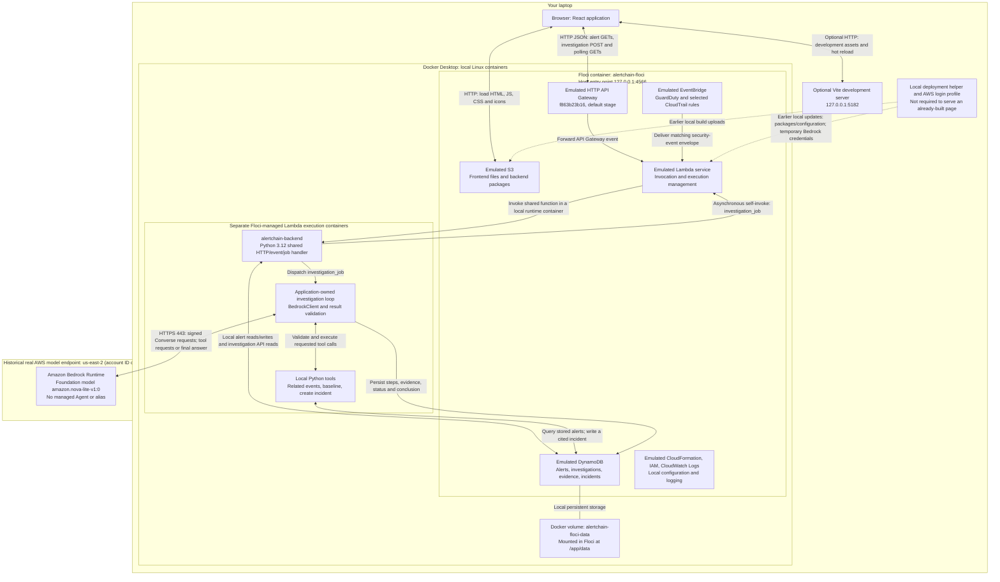

# Historical AlertChain architecture snapshot — November 16, 2026 (superseded)

> **Superseded historical documentation.** This snapshot records the November 16
> deployment, before live FA3 integration and the subsequent local-stub verification.
> References below to "current", Nova Lite, real Bedrock credentials/endpoints,
> missing FA3 features, and record counts describe that date only. They are not
> current setup instructions or evidence of actual Nova Micro inference.
> Use [local setup](local-setup.md) and the
> [November 25 verification report](local-floci-verification-2026-11-25.md) for the
> supported local-stub workflow and latest recorded verification. Real AWS account
> identifiers have been omitted from this historical copy.

Read-only architecture review on **November 16, 2026**, after integration. Source:
checked-out branch `feature/fa1-arch_2`, commit
`4f823b8e29c2d72d44862ce1c1016191c2ed57db`, live local service metadata, consistent
DynamoDB reads, saved verification evidence, and browser GET requests. No deployment,
new investigation, Bedrock invocation, credential refresh, commit, or push was
performed for this document.

## 1. What is working, configured, and unfinished

| State | What the evidence supports |
| --- | --- |
| **Working locally** | Floci and the frontend respond over HTTP. The backend serves stored alerts, filters, ordering, pagination, details, exact raw JSON, and incident associations. All 17 alerts, including the 14 originals, still equal the integration's original baseline. |
| **Working investigation plumbing** | Earlier browser verification observed POST -> asynchronous Lambda job -> persisted terminal state using Floci's Bedrock stub. It correctly reported NEEDS_HUMAN_REVIEW, not a fabricated successful verdict. |
| **Completed stored run now observable** | The database now contains `INV-05da65ad0b13`, status COMPLETED, four recorded steps, three evidence records, and incident `INC-C6856B6A`. A fresh read-only browser check displayed its verdict and citations. These records appeared after the earlier integration snapshots and were preserved. |
| **Real AWS connection configured** | The local worker is configured for Bedrock Runtime, regional Nova Lite, and separate temporary AWS credentials. Earlier read-only AWS checks reported model availability/authorization. This documentation task did not invoke the model or test whether those credentials are still valid. |
| **Not independently verified here** | A new charged real-model test was skipped in the integration session at the user's request. The newly observed completed run is consistent with the real-endpoint configuration, but its individual AWS request IDs, billing, and model-response provenance were not independently audited. A stored HIGH-confidence result is not proof that its security analysis is correct. |
| **Still incomplete/planned** | Live FA3 dashboard/report/Ask-the-Agent integration, live report retrieval, full live attack-chain visualization, durable closeout, populated actor baselines, and deployment of the application infrastructure to real AWS. |

The earlier integration report correctly recorded **17 / 0 / 0 / 0** after its
disposable tests were cleaned up. Current live counts are **17 / 1 / 3 / 1** for
alerts / investigations / evidence / incidents. This document describes that newer
observed state; the historical report has not been rewritten.

## 2. Architecture and boundaries

The nested boxes matter: **Floci emulates the services, but the Python function
executes in a sibling Docker container**, launched through Floci's mounted Docker
socket. It does not execute inside the browser, Vite, or the Floci service process.
An execution container was observed with `/lambda-entrypoint.sh`, command
`handler.handler`, and Docker bridge networking. Names follow
`floci-aws-alertchain-backend-*` and change as Floci recycles workers.

The diagram's real-AWS model arrow is the configured runtime path. Drawing that
arrow does not mean a new model call was made during this review. Credential-copy
arrows describe earlier deployment, not an action performed for this document.

## 3. Browser URLs and ports

| Purpose | Actual address |
| --- | --- |
| Deployed frontend, Alerts screen | <http://alertchain-frontend-local.s3-website-us-east-2.localhost.floci.io:4566/#/alerts> |
| Optional Vite frontend, currently listening | <http://127.0.0.1:5182/#/alerts> |
| Local backend base URL | <http://f863b23b16.execute-api.localhost.floci.io:4566> |
| Local health check | <http://f863b23b16.execute-api.localhost.floci.io:4566/health> |
| Host-side emulated AWS service endpoint | `http://127.0.0.1:4566` |
| Container-side DynamoDB and Lambda endpoint | `http://host.docker.internal:4566` |
| Configured real model endpoint | `https://bedrock-runtime.us-east-2.amazonaws.com` on HTTPS port 443 |

The deployed frontend is a Vite-built React application: Floci S3 supplies static
files, then JavaScript runs in the browser. Vite is needed only for the alternative
development URL. Both the website and development server were responding with 200
during this review; there is no required FastAPI development server on port 8000.

The long `*.localhost.floci.io` hostnames resolve to loopback; they are not remote
AWS websites. Floci distinguishes the emulated website/API by the hostname while
sharing port 4566. Docker publishes that port on `127.0.0.1`, not the whole network.
For a teammate on another computer, screen-share; the loopback URLs refer to their
own computer if opened there.

React uses hash routes. In `/#/alerts`, the browser sends the server the root path;
React interprets the part after `#`. The frontend then makes separate HTTP JSON
requests to the API hostname. It does not read DynamoDB directly. The API's current
CORS allowlist contains the exact Floci website origin and `http://127.0.0.1:5182`,
with GET, POST, OPTIONS and Content-Type allowed. Other host/port combinations are
not automatically equivalent. CORS is a browser permission rule, not authentication.

The production build and preserved `.env.local` select `VITE_USE_MOCK=false` and
point both `VITE_API_URL` and `VITE_API_BASE_URL` to the local API. FA1 and FA2 now
agree on URL precedence. This switch makes their API-backed flows live; it does
not convert FA3's separately imported fixtures into backend data.

## 4. Emulated services and deployed resources

Floci 2.4.0 runs as `alertchain-floci` under Docker Desktop. The existing named
volume `alertchain-floci-data` is mounted at `/app/data`; the Docker socket is also
mounted so Floci can manage execution containers. No volume/container was recreated.

| Emulated service/resource | Purpose |
| --- | --- |
| CloudFormation stack `alertchain-local` | Describes and updates local resources using the SAM template. This is not a stack deployed to real AWS. |
| S3 bucket `alertchain-frontend-local` | Serves the built HTML, JavaScript, CSS and icons. Old hashed assets were retained for already-open tabs. |
| S3 bucket `alertchain-local-artifacts` | Stores packaged backend deployment artifacts; not an alert evidence store. |
| HTTP API `f863b23b16`, `$default` stage | Receives browser HTTP requests and forwards events to the shared function. Includes route integrations and invoke permissions. |
| Lambda `alertchain-backend` | Shared Python 3.12 handler for health, alerts, investigation HTTP requests, ingestion and background jobs. Effective settings: 512 MB, 120-second function timeout. FastAPI/Pydantic Linux dependencies are packaged with it. |
| EventBridge default bus and two ENABLED rules | Select GuardDuty findings and the two supported CloudTrail action/service pairs. Each currently targets the local backend function. |
| IAM role `alertchain-local-BackendExecutionRole-a8a342b683c2` and permissions | Local execution-policy declarations for logs, storage, invocation and the agent. They are not the real human profile's Bedrock permissions. Floci behavior does not validate real AWS IAM enforcement. |
| CloudWatch Logs | Template declares `/alertchain/backend` with one-day retention. Effective local Lambda configuration instead reports `/aws/lambda/alertchain-backend`. The default group now contains events; the custom group returned none. This emulator mismatch remains. |

The app uses these emulated services; this is not a claim that every feature of
those services, or all AWS services, is emulated with production parity. Local
ARNs often contain Floci's placeholder project/account ID `000000000000`; that is
not the real AWS project used for Bedrock.

### The four DynamoDB tables

| Table | Key and useful indexes | Stored information | Current records |
| --- | --- | --- | ---: |
| `alertchain-alerts` | `alertId`; `alertsByTime`, `alertsByPrincipalAndTime` | Normalized security events, source/caller/resource/severity/status/time, original raw event detail | 17 |
| `alertchain-investigations` | `investigation_id` | Starting alert, run status, recorded tool/reasoning steps, optional conclusion or failure reason | 1 |
| `alertchain-evidence` | `evidence_id`; `evidenceByInvestigation` | Successful tool results, summaries and raw input/output, linked to the investigation | 3 |
| `alertchain-incidents` | `incident_id`; `incidentsByInvestigation` | A security case created by the local create_incident tool, with alert/investigation links and cited evidence | 1 |

The template specifies on-demand DynamoDB billing for eventual AWS use; local
emulation is not proof of production billing behavior. All 17 current alert records
were compared with the original integration baseline and are unchanged. Fourteen
have creation times before November 15 and are the original cases.

## 5. Security event ingestion

The implemented path is:

1. An event is published to the local EventBridge bus, for example by a local
   synthetic test publisher. This local setup is not automatically subscribed to
   a real AWS project's security feed.
2. The GuardDuty rule matches `aws.guardduty` / `GuardDuty Finding`. The selected
   CloudTrail rule matches CreateAccessKey from IAM or StopLogging from CloudTrail,
   with detail type `AWS API Call via CloudTrail`.
3. EventBridge invokes the shared Lambda with the event envelope, rather than an
   HTTP request. The handler chooses the appropriate normalizer.
4. The normalizer validates required values, standardizes UTC times and source/
   severity/status fields, separates the caller from the affected resource, and
   keeps a copy of the original event detail.
5. Stable IDs are derived from a GuardDuty finding ARN or the underlying CloudTrail
   event ID. The repository writes only if the alert key does not already exist.
   Redelivery therefore does not overwrite the original record or creation time.

This is implemented and covered by the saved ingestion/backend tests and earlier
Floci work. No new event was published during the integration browser review or
this documentation audit. Real GuardDuty findings, a live CloudTrail trail, and
automatic forwarding from real AWS are not demonstrated by the stored synthetic cases.

## 6. Reading stored alerts

| Request | What it reads and returns |
| --- | --- |
| GET `/health` | Local function health; does not test Bedrock. |
| GET `/alerts` | Queries `alertsByTime`, orders newest timestamp then descending ID, applies server-side search/filtering, returns a numbered page and total count. The UI uses six rows per page. |
| GET `/alerts/{id}` | Reads one normalized alert consistently from the base table, enriches a few display fields, and returns its details. |
| GET `/alerts/{id}/raw-event` | Separately reads the exact stored raw event detail. |
| GET `/alerts/{id}/associated-incident` | Separately scans local incident records referencing the alert and returns none, associated with one ID, or ambiguous with no arbitrary ID chosen. |

The browser never substitutes FA1 fixtures when a live request fails. Raw-event
and association requests have independent loading/error states. Saved browser/HAR
checks compared all 17 visible IDs and response fields against DynamoDB, including
ordering, pagination, a combined case-insensitive filter and raw JSON fidelity.
All three association outcomes were tested using two owned disposable records,
then those records were removed. The current permanent association links alert
`ebe7e4ea-4e5b-5f95-99c4-f95566e27ecf` to `INC-C6856B6A`.

Use **All time** to see the preserved November 1 events; the default Last 24 hours
can legitimately show no matches. These small-data paging/association implementations
read all matching index pages or scan incidents; they are not production-scale
pagination or association-index designs.

## 7. What clicking Investigate does

1. FA1 passes the displayed alert to FA2. A below-threshold alert may require the
   application's low-severity confirmation. FA2 can reuse a run already known in
   its current in-memory screen state; this is not a backend-wide deduplication guarantee.
2. The browser sends POST `/investigations` with `alertId`. The local API forwards
   that request to the shared Lambda. Its HTTP controller adapts the FastAPI router;
   there is no separate hosted FastAPI server in this path.
3. The router confirms that the alert exists, saves a new RUNNING record in local
   DynamoDB, and asks LambdaSelfInvokeLauncher to start the run. The launcher uses
   the local Lambda endpoint with asynchronous InvocationType Event and an
   `investigation_job` payload. The browser receives 202 and the investigation ID.
4. Floci invokes the same function as a background job. A worker's Python runtime
   builds the application orchestrator, DynamoDB repositories, tool registry and
   Bedrock client. It does not rely on request-process memory being shared with the job.
5. The orchestrator asks the foundation model for a next action or final answer.
   When the model requests a tool, local Python validates and executes it. Successful
   tool results become evidence; step records and progress are written locally.
6. The model receives tool results in subsequent Converse messages. A valid final
   JSON answer becomes a conclusion with summary, severity, confidence, attack-chain
   descriptions and evidence references. The application validates its structure and
   cited IDs. A completed parse/citation check does not establish factual correctness.
7. Terminal states are COMPLETED, NEEDS_HUMAN_REVIEW (for example, unusable final
   JSON or step limit), or FAILED (for example, a model call fails). The default
   loop permits six model turns and uses a 90-second budget checked between calls;
   it cannot interrupt an in-flight request. Bedrock read timeout is 60 seconds
   with SDK retries, and the outer function timeout is 120 seconds, so failures
   can still need investigation if a worker terminates before saving a final state.
8. The browser polls GET `/investigations/{id}` about every two seconds while
   RUNNING. The response joins the stored investigation and evidence. FA2 maps it
   into the reasoning trace and overview verdict, showing citations and textual
   attack-chain stages. It can reload an existing investigation by URL.

**Verdict versus report:** FA2's live verdict is implemented. The separate FA3
incident report is still a fixture-backed prototype. Creating an incident row does
not create a working FA3 report. The live Open incident button remains disabled,
and the actual `/incidents/INC-C6856B6A` page showed “Incident unavailable” without
substituting a different incident. The investigation response also does not supply
a live incidentId handoff, and FA2's separate graph model remains empty for API runs.

### What is currently visible without starting a run

The stored investigation `INV-05da65ad0b13` recorded get_related_events,
check_actor_baseline, create_incident, and a final answer, ending at
**10:43:49 a.m. Toronto time on November 16**. It has three evidence records and
the linked incident. A read-only browser GET rendered the stored HIGH-severity /
HIGH-confidence verdict and three citations. This documents observed stored output,
not a new invocation or an endorsement of that verdict on synthetic events.

## 8. Exactly how Bedrock connects

### Foundation model, caller and AWS project

The application calls a **foundation model directly through Bedrock Runtime
Converse**. The word “agent” refers to AlertChain's own Python orchestration loop.
There is **no configured managed Bedrock Agent, Agent ID, agent alias, Knowledge
Base, or AgentCore runtime** in this path.

| Item | Effective setting |
| --- | --- |
| Real AWS project containing the signing identity | Account ID omitted; identity was checked in the earlier integration session |
| Selected Region | `us-east-2` |
| Foundation model ID | `amazon.nova-lite-v1:0` |
| Model ARN form | `arn:aws:bedrock:us-east-2::foundation-model/amazon.nova-lite-v1:0` (AWS-owned foundation model, not an agent in a teammate's project) |
| Endpoint | `https://bedrock-runtime.us-east-2.amazonaws.com` |
| SDK call | Python boto3 `bedrock-runtime.converse(...)` |
| Caller process | Python code in a local Floci-managed Lambda execution container |
| Managed agent ID / alias | Not applicable; none used |

Earlier metadata checks found Nova Lite authorized and available for regional
on-demand use. The generic SDK class still has a historical Nova Micro fallback,
but the running Lambda's explicit `BEDROCK_MODEL_ID` overrides it. The local helper
and template now default to regional Nova Lite. The `us.amazon.nova-micro-v1:0`
cross-Region inference profile was not used for this managed project.

### Credential path, without secret values

The Windows AWS CLI profile is named `alertchain`. The user refreshes it through
AWS login. During the earlier local deployment, the helper exported temporary
credentials from that profile and supplied NoEcho CloudFormation parameters to
the **local Floci stack**. The function receives them in
`BEDROCK_AWS_ACCESS_KEY_ID`, `BEDROCK_AWS_SECRET_ACCESS_KEY`, and
`BEDROCK_AWS_SESSION_TOKEN` environment variables. Their values are intentionally
omitted from this document.

BedrockClient passes those credentials explicitly to the Bedrock Runtime client
and pins its public HTTPS endpoint. DynamoDB and Lambda clients instead use the
local endpoints and Floci's dummy runtime credentials. The browser gets neither
the real credentials nor direct Bedrock access. The local emulated execution role
does not grant real AWS access; the exported profile identity's permissions govern
the real call. This does not assume access to a teammate's project/resources.

Those credentials are a deployment-time snapshot, not a live link to the host
profile. They expire and are not automatically renewed by a later host login.
They were present in the function configuration during this audit; their presence
does not prove current validity. Refreshing them requires the documented login /
local update workflow. No refresh was performed here. Local deployment parameter
files and configuration backups can contain secrets despite NoEcho, so keep them
private and outside Git.

### What leaves the laptop, and who executes tools

The first Converse request contains the application system instructions, an initial
message naming the alert ID, and the available tool schemas. It sets maximum output
to 600 tokens and temperature to zero. Later requests carry the conversation,
model tool requests and local tool results.

| Tool executed locally | Result that can be sent back to the model |
| --- | --- |
| `get_related_events` | The selected stored alert, including raw event detail, plus up to 25 other stored alerts for the same principal, newest first. Current code uses that principal index, not a general live AWS/IP/time-window search. |
| `check_actor_baseline` | Actor and baseline comparison result. The current runtime has no baseline table/data and returns “no baseline exists.” |
| `create_incident` | A locally created or already-existing incident, with title, severity, summary, links and cited evidence. Known evidence IDs are checked before creating it. |

Local tool result data can include principal names, resource IDs, IP addresses,
event times and complete raw event fields. The implementation does not redact those
fields before placing the tool result in the model conversation. These bytes leave
the laptop during a real investigation even though the authoritative databases
remain local. Credentials are used to sign transport requests, not inserted into
the model prompt by this code; this is not a guarantee that arbitrary ingested
raw event content contains no sensitive information.

**Bedrock never connects to Floci or calls these Python tools itself.** It returns
a tool-use request. AlertChain validates that request, runs the tool in its local
worker, saves evidence, and sends the result back to Bedrock. No browser credentials,
public DynamoDB exposure or managed-Agent action group is needed for this loop.

The model response is parsed locally. Successful tool outputs are stored in
`alertchain-evidence`; steps/status/conclusion are stored in
`alertchain-investigations`; create_incident writes `alertchain-incidents`.
The browser receives those stored results through its local GET API, not directly
from AWS. Recorded “reasoning” is the application's saved model/tool trace; it
should not be presented as a full or independently reliable account of model reasoning.

## 9. Internet, login and failure behavior

| Operation | Internet / valid real AWS credentials required? |
| --- | --- |
| Serve already-built local frontend, call health, browse stored alerts and raw events | No real AWS login or model access. Docker/Floci and the local API must be running. The chosen `localhost.floci.io` hostname must resolve; offline DNS/cache behavior is separate from Bedrock access. |
| Read stored investigations, evidence, verdicts and incident associations | No model call or real AWS login; only local API/storage. |
| Render FA3 prototype pages | Uses locally served fixture data; does not establish live report support. |
| Start a new real investigation | Worker needs outbound HTTPS, valid temporary signing credentials, permitted regional Bedrock access and usage allowance. It can incur charges. |
| Refresh credentials | Host needs internet and a valid AWS login session; worker credentials still need the local refresh/deploy workflow. |
| Reinstall packages, pull missing Docker images, or resolve external hostnames uncached | May require internet; this differs from running the already-prepared environment. |

Bedrock is initialized lazily, so it does not block health, ingestion, alert reads,
or retrieval of saved results. A model outage or expired token can make a new run
FAILED while those local functions continue working. Polling the saved failure
does not invoke Bedrock again. The UI does not automatically replace failures with
fixture answers. The optional Floci Bedrock stub is a separately selected diagnostic
mode; the effective current endpoint is real AWS, not that stub.

## 10. Remaining limits and evidence

- Live FA3 report retrieval, dashboard data and Ask the Agent are still missing.
  A stored incident is not a full integrated live report. Live graph/closeout
  mappings also remain unfinished.
- Actor baselines are empty. The model's confidence must be interpreted in light
  of missing baseline data and synthetic source events.
- Source connection controls/event editing remain simulated. Real GuardDuty /
  CloudTrail ingestion from AWS was not established by this local demonstration.
- Local APIs have no configured production user authentication/authorizer in this
  template. Loopback binding and CORS are not a production access-control design.
- Floci persistence, IAM enforcement, SAM transformation, logging and service
  behavior do not establish real AWS parity. The intended custom log-group setting
  differs from the effective local default group; the latter now has log events.
- Application guardrails validate tool names/inputs and evidence IDs, but they do
  not independently validate every security inference. A completed run is not a
  model-quality evaluation. Per-call AWS provenance/billing was not audited here.
- Region-local model credentials expire; Lambda does not follow host login refresh.
  Generic source fallbacks/IAM examples still need review before any AWS deployment.
- The separate `feature/aws-deployment` preparation remains outside this branch's
  integration. No AlertChain infrastructure was deployed to real AWS in this work.

Sources for reproducing the explanation:

| Evidence | What it establishes |
| --- | --- |
| [template.yaml](../template.yaml), [handler](../backend/handler.py) | Local resources, environment wiring and HTTP/event/job dispatch |
| [deployment helper](../scripts/floci-j11.py), [Bedrock client](../backend/infra/bedrock/client.py) | Profile export, endpoint separation, regional model parameter and explicit signed Converse client |
| [runtime](../backend/agent/runtime.py), [launcher](../backend/agent/launcher.py), [orchestrator](../backend/agent/orchestrator.py), [tools](../backend/agent/tools.py) | Application-owned tool loop, local self-invocation, persistence and tool data sent back |
| [alert repository](../backend/infra/dynamodb/alerts.py), [investigation repositories](../backend/infra/dynamodb/investigations.py) | Stored data shape, reads, ordering, related alerts and associations |
| [FA2 API adapter](../src/fa2/api.js), [FA2 verdict UI](../src/fa2/InvestigationOverview.jsx), [FA3 app](../src/fa3/Fa3App.jsx) | Live polling/verdict versus fixture-backed report boundary |
| [integration report](fa1-main-integration-2026-11-16.md), [startup guide](fa1-integration-startup.md) | Historical checks, 318 backend / 29 frontend unit / 25 browser test passes, setup and limitations |
| Ignored `test-results/integration/` HARs, summaries, screenshots and manifests | Earlier actual-browser storage comparisons, stub dispatch and final read-only verification |
| Current local metadata/consistent scans and read-only browser GETs | Current endpoints, resource counts, unchanged original alerts, completed run, displayed verdict/citations and disabled/unavailable live report |

This review changed only this Markdown document. It preserved the newly observed
investigation/evidence/incident records and did not run any cleanup or model test.

## Professor-ready explanation

“AlertChain runs its website, API, event routing and databases locally using Floci
in Docker. Security events are normalized into DynamoDB, and the browser reads
those stored alerts through our API. Our Python investigation worker can call
Amazon Nova Lite in real AWS. The model requests tools, but our local Python code
executes them, stores evidence and sends results back. We can display a saved
investigation verdict and citations; the separate live incident-report and
Ask-the-Agent features are still unfinished. The original 14 alert cases remain
preserved. Reviewing this architecture did not start another model call.”
